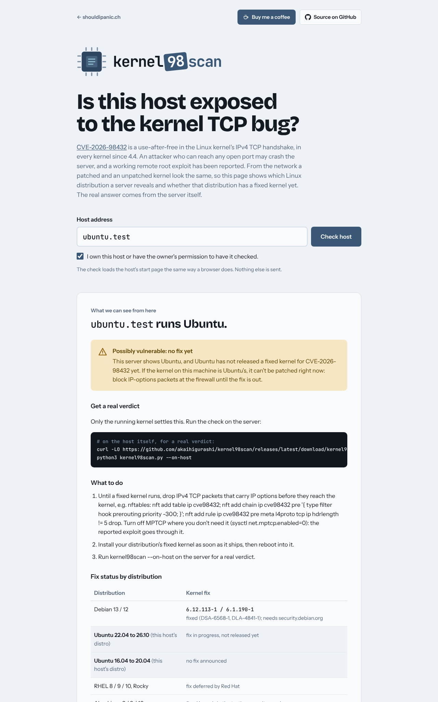

<h1>
  <picture>
    <source media="(prefers-color-scheme: dark)" srcset="docs/logo-dark.png">
    
  </picture>
</h1>

Checks whether a Linux host may be exposed to **CVE-2026-98432**, the
use-after-free in the kernel's IPv4 TCP handshake. Part of
[shouldipanic.ch](https://shouldipanic.ch).

A SYN carrying IPv4 options (Record Route, Timestamp) reaches code that reads the
options after they may already have been freed. Any open IPv4 TCP port is enough,
no login needed. It's in every kernel since 4.4 (2016) until the fixed release of
each tree: 5.10.272, 5.15.223, 6.1.190, 6.6.159, 6.12.113, 6.18.56, 7.2.10, 7.3.
The kernel CNA scores it 9.8; a working remote root exploit against servers with
MPTCP listeners has been reported (not published). The fix is invisible on the
wire: a fixed kernel answers exactly like an unpatched one.

That shapes what each mode can say:

- **`--on-host`** reads the running kernel on the machine itself: its version,
  the package changelog and whether a newer kernel waits for a reboot.
- **From outside** nobody can read the kernel. kernel98scan reads the Linux
  distribution from the HTTP `Server` header and shows whether that distribution
  has released a fixed kernel yet. That's a strong hint, not a verdict: behind a
  reverse proxy or inside a container the kernel belongs to another machine.

kernel98scan comes in two forms:

- **`kernel98scan.py`**: a single Python file with no dependencies. On a host,
  `--on-host` gives the real verdict; pointed at addresses it does distribution
  fingerprinting over IP ranges, with a port scan and vhost discovery.
- **A web page** (Docker image) where anyone can check one host from outside,
  with abuse protection. It runs at
  [kernel98scan.shouldipanic.ch](https://kernel98scan.shouldipanic.ch).



## Command line

```bash
curl -LO https://github.com/akaihigurashi/kernel98scan/releases/latest/download/kernel98scan.py
python3 kernel98scan.py --on-host           # real verdict for THIS machine
```

Python 3.8 or newer, nothing to install. Examples:

```bash
python3 kernel98scan.py --on-host                       # read the running kernel
python3 kernel98scan.py 203.0.113.10                    # outside: distribution + fix status
python3 kernel98scan.py 203.0.113.0/24                  # a whole range from outside
python3 kernel98scan.py 203.0.113.10 --ip-options       # + do IP-options packets get through?
python3 kernel98scan.py 203.0.113.10 -o out.csv         # CSV output
python3 kernel98scan.py -h                              # all options
```

On the host (`--on-host`, exit code 2 / 1 / 0 / 3):

| Status | Meaning |
|---|---|
| `VULNERABLE` | Nothing shows the fix in the running kernel |
| `CHECK` | A fixed kernel is installed, but the old one is still running: reboot |
| `FIXED` | The kernel changelog names the CVE, or a plain upstream kernel is at the fixed version |

Vendor kernels (Ubuntu, RHEL, Proxmox) backport fixes onto old version numbers, so
for them only the changelog counts. It also shows whether MPTCP is on (the reported
exploit goes through MPTCP listeners) and `tcp_migrate_req`.

From outside:

| Status | Meaning |
|---|---|
| `POSSIBLY VULNERABLE` | The banner shows a Linux distribution: either it has no fixed kernel yet (Ubuntu, RHEL and rebuilds today) or it has one, which has to be installed and booted |
| `UNKNOWN` | The distribution isn't visible, or a proxy/CDN answers |
| `NOT LINUX` | The `Server` header points at a non-Linux host |

`VULNERABLE` and `PATCHED` are never reported from outside. The fix status per
distribution is a table in [`check.py`](check.py) (`FIX_STATUS`, `FIXED_TABLE`),
updated with each vendor release.

| Option | What it does |
|---|---|
| `--on-host` | Read the running kernel on this machine and give a real verdict |
| `--ip-options` | One connection whose SYN carries a Record-Route IP option (see below) |
| `-o FILE` | Also write all results to CSV |
| `-a` / `-v` | Show hidden results / show the evidence |
| `-d` | Debug: every request, header and match |
| `-q` | No banner (for scripts) |
| `-V` | Print the version |
| `-h` | All options |

### `--ip-options` (opt-in, command line only)

Opens one normal connection and one whose SYN carries an empty Record-Route IP
option, and reports whether such packets reach the host (`reach`), are dropped
on the way (`filtered`) or the port is closed (`noport`). That is the packet
shape the bug is reached through, so it is off by default and never runs on the
web page: use it on your own hosts, for example to confirm that your firewall
drops IP options. A single connect can't win the race the bug needs, and a
`filtered` result can be any network in between.

### Mitigation until a fixed kernel runs

```bash
nft add table ip cve98432
nft add chain ip cve98432 pre '{ type filter hook prerouting priority -300; }'
nft add rule ip cve98432 pre meta l4proto tcp ip hdrlength != 5 drop
sysctl -w net.mptcp.enabled=0     # if you don't need MPTCP
```

Drops IPv4 TCP packets that carry any IP options. Not persistent across reboots,
and not a replacement for the fixed kernel.

## Web page with Docker

```bash
docker run -d --name kernel98scan --restart unless-stopped \
  -p 127.0.0.1:8092:8092 \
  -e PANIC_ORIGIN=https://kernel98scan.example.ch \
  -v kernel98scan-data:/data \
  ghcr.io/akaihigurashi/kernel98scan:latest
```

Or with Compose: download [`docker-compose.yml`](docker-compose.yml), set
`PANIC_ORIGIN`, then `docker compose up -d`. The container listens on localhost
only; put a reverse proxy with TLS in front of it
([nginx example](deploy/nginx.conf)).

| Variable | Default | Purpose |
|---|---|---|
| `PANIC_ORIGIN` | – | Public address. Requests from other origins are refused. **Set it.** |
| `PANIC_OPERATOR` / `PANIC_CONTACT` | – | Optional contact section at the bottom of the page |
| `PANIC_IMPRINT_URL` | – | Optional link to an existing imprint |
| `PANIC_TRUSTED_PROXY` | `127.0.0.1,::1` | Proxies whose `X-Real-IP` header is trusted |
| `PANIC_DENY_HOSTS` / `PANIC_DENY_IPS` | – | Never check these domains / addresses |
| `PANIC_AUDIT_DIR` | `/data/audit` | Daily audit log files |
| `PANIC_RETENTION_DAYS` | `30` | Audit files older than this are deleted |

The page has the same protections as
[php2scan](https://github.com/akaihigurashi/php2scan#abuse-protection): consent
checkbox, audit log, VPN/Tor/datacenter clients refused, rate limit, result cache,
public hostnames only with the connection pinned to the checked address, hosts
that are never checked (well-known services, the 100 most visited sites,
government sites, sanctioned countries), and no access from sanctioned countries.
The web page only loads the start page; it never sends IP options.

## How it's built

The scanner engine (fetching, fingerprinting, port scan, vhost discovery, web
server) lives in [panic-core](https://github.com/akaihigurashi/panic-core).
Everything specific to CVE-2026-98432 is in [`check.py`](check.py).
`kernel98scan.py` and `web.py` are generated from both:

```bash
git clone https://github.com/akaihigurashi/panic-core ../panic-core
python3 ../panic-core/bundle.py check.py
```

## License

GPL-3.0, see [LICENSE](LICENSE). Fonts:
Bricolage Grotesque, Instrument Sans and JetBrains Mono (SIL Open Font License).
